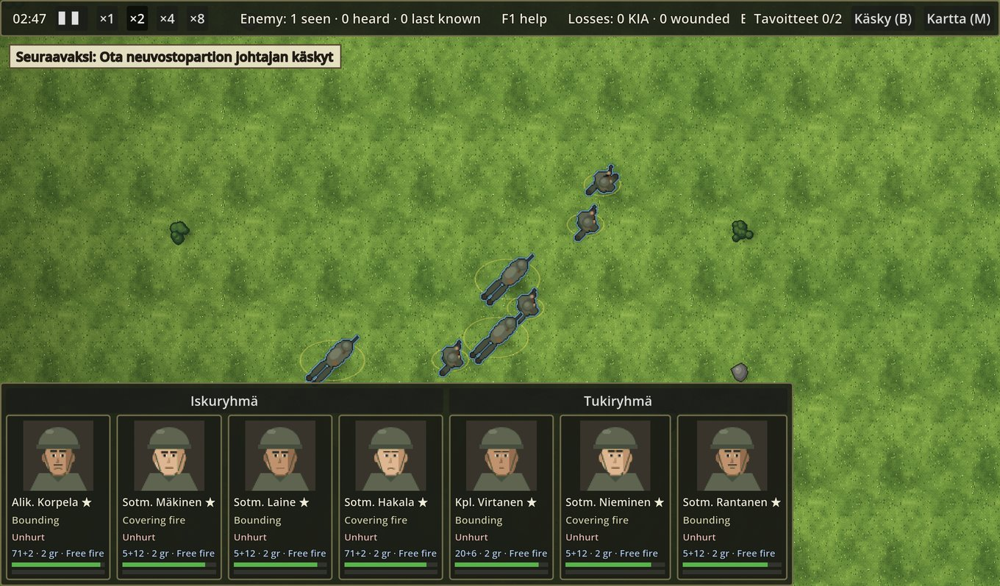
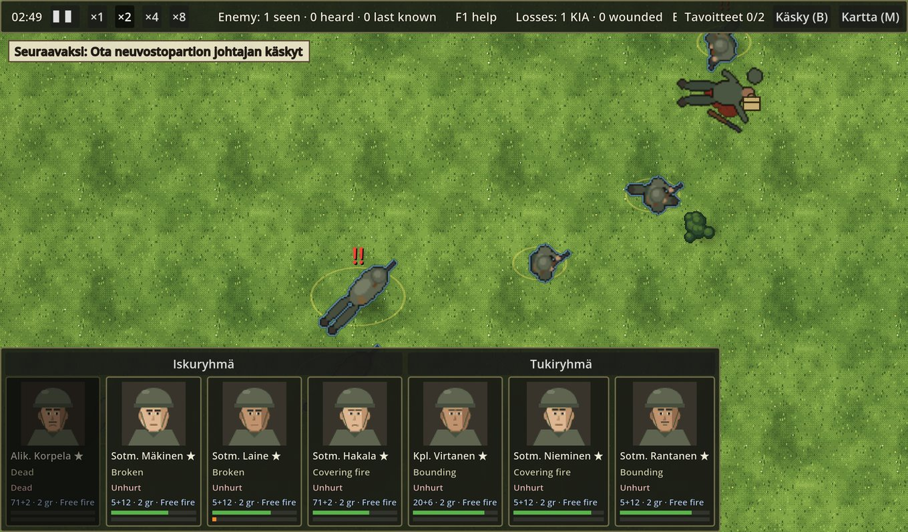
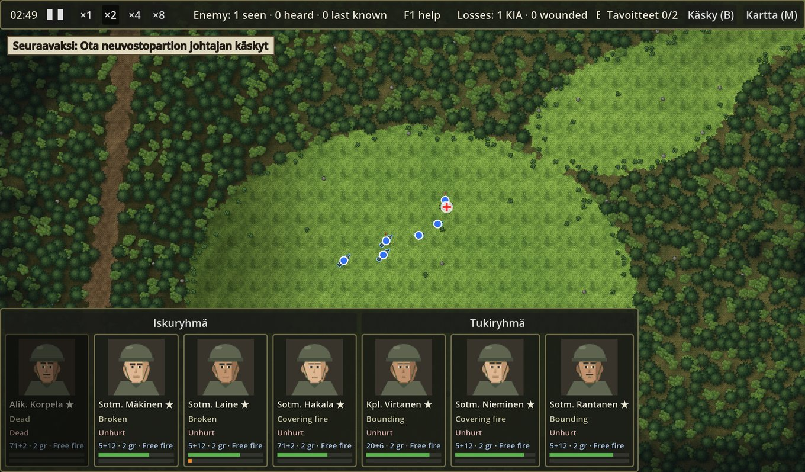
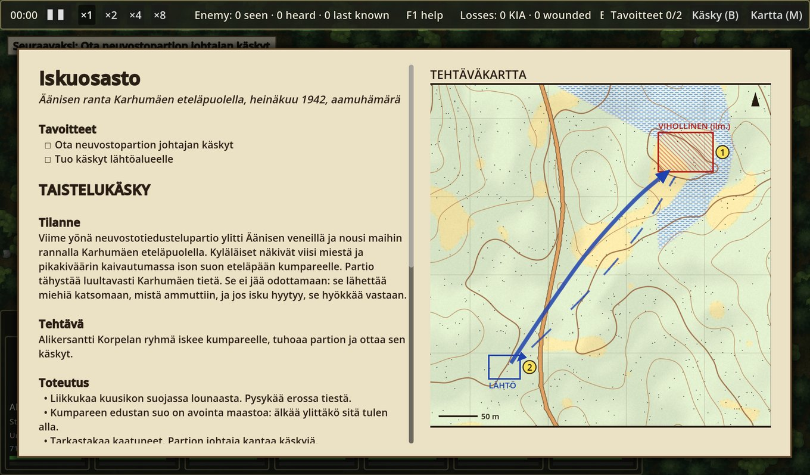
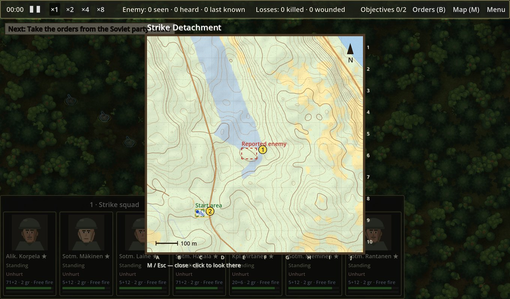

# No Man's Forest

**A free, open-source WW2 squad tactics game set in the Finnish Continuation War, 1942.**
Real-time squad fighting in the spirit of *Close Combat*, men with names and nerves as in *Jagged Alliance 2*,
leadership and morale as in *Squad Leader* — on a kilometre of real Karelian terrain.



[English](#english) · [Suomeksi](#suomeksi)

---

## English

### The game

You command a Finnish platoon of two squads — Alik. Korpela's strike squad and Kpl. Virtanen's support squad
with its Lahti-Saloranta machine gun — against a Soviet reconnaissance party dug in on a knoll south of
Karhumäki, on the Lake Onega shore, at dawn in July 1942. Take the Soviet leader's orders and bring them back.

In the second mission, **The Wreck**, Kers. Lehto's ski patrol goes behind the Soviet line east of Povenets at dusk in
January 1943, through half a metre of snow, to find a downed reconnaissance plane and pull its wounded pilot home on an
ahkio, while a Soviet search party makes for the wreck too and a post on the lake shore can telephone for its reserve.

**The campaign**, *Lehto's Platoon*, plays the two as chapters with one platoon whose men live on: the fallen stay
fallen, the badly wounded sit the next mission out, and every man earns experience for coming through, his hits and
the enemies he puts down. A failed chapter is played again with the losses kept. Each mission's own men take their own
places; when one is gone, the best leader left takes a leader's place and the most experienced man any other.
Points make levels (Recruit, Seasoned, Veteran, Old hand) that steady a man's nerve and experience, hits sharpen his
aim, and a leader who comes through leads better. A seasoned man may specialise once: **marksman** (a steadier rifle),
**scout** (sees sooner, seen and heard less on the move), **sapper** (more grenades thrown truer, a wire cut in half the
time) or **medic** (binds a bad wound so the man does not bleed out: right click the wounded man, or he does it himself).

You don't micromanage: **click where to go, and the men do their best.** They pick their pace, take cover, fire
back, drop prone when bullets crack past, get pinned or break, and are rallied by their leaders.

- **Planned attacks.** Double click an enemy: the men plan an attack on his position from what they know. The fire
  team takes a fire base where it sees the position and keeps it down, the strike team goes round off the line of
  fire and goes in once every man of the position seen is down; or, against too many, long fire from a distance. They
  halt by themselves on losses, a fallen leader or a position that will not go down, and tell you why.
- **See the plan first.** The double click stops the game and draws the plan: the fire base and its line of fire, the
  strike team's way (red where the enemy sees it), the form-up. Pick another tactic (1–4), drag the fire base, the
  form-up or the way, and start with Enter, or cancel with Esc. Attacks under way stay on the map, faded, and the
  cards tell each man's part. The preview can be turned off in the settings.
- **Infiltration.** Old hands can creep in instead: the whole group sneaks, holding its fire, by the way least seen or
  heard to a hidden form-up 18–30 m off, throws its grenades and goes in. Found out far off, they halt and tell you.
  It is suggested when a fire base could not see the position and the way in can be hidden. A mission can prefer or
  forbid tactics (`tactics: { prefer: [...], forbid: [...] }` in mission.yaml).
- **Area fire.** Ctrl/Cmd + click, or click a "?" where an enemy was last seen or heard: keep his position under
  fire even when you cannot see him.
- **Men, not units.** Every man has nerve, morale, marksmanship, experience and (for leaders) leadership.
  Veterans move harder to hit and see the moment to go in; the toughest (★) hold their ground under fire.
- **An enemy that thinks.** The Soviet commander scouts where he hears shots, holds his post, and counterattacks
  with his reserve when your attack falters — planned like yours: the post keeps you down from where it is while the
  reserve goes round. His "Urraa!" is heard across the woods.
- **Sentries that can be slipped past.** A mission can start the enemy calm: each man notices slowly, wakes to what he
  hears and sees himself ("?" wary, "!" alerted), and the alarm spreads by shouts, shots, flares and a field telephone
  whose wire you can cut. A search party can race you to a place (vartiokoe, `--debug`).
- **Winter and the dark.** A mission can be set in snow (`winter: { snow_cm: 40 }`): men on foot sink in, skis are
  quick, an ahkio pulls the wounded, and every man leaves tracks the enemy notices and follows. At dusk or night
  (`light: dusk|night`) everyone is slower to make anyone out; a flare lights 200 m round it (talvikoe, `--debug`).
- **Fog of war.** You only see what your men see; heard movement shows as a "?", last-known positions linger.
- **Always know where to go.** The next objective is on a paper strip, and an arrow at the edge of the screen points
  the way with the distance — back to the start area with the papers, above all.
- **Real terrain.** The map is 1 km × 1 km of real ground (OpenStreetMap and ASTER elevation), with bogs, spruce and
  pine forest, birches by the openings, windfalls, boulders and a knoll with foxholes, changed a little to look like 1942.
  Ferns, moss, flowers, sedge and cotton grass are scattered in patches, and no two trees are quite alike.
- **Ballistics, not dice.** Every bullet flies: cover stops it, the ground stops it, a miss close by suppresses.
- **Deterministic.** The simulation is integer-only and replays exactly from its order log.

| | |
|---|---|
|  |  |
| *The fight at close range: cards show what every man is doing.* | *Zoomed far out: men as markers, fire and hits as signals.* |
|  |  |
| *The orders, with the attack and withdrawal routes.* | *The map of the area: what your men know.* |

### Download and play

No installing: download the zip for your computer from the
[**Releases page**](https://github.com/trotor/no-mans-forest/releases/latest), unzip it anywhere and start the game.
Keep the `content` folder next to it.

| | |
|---|---|
| **Windows** | Double-click `NoMansForest.exe`. If SmartScreen warns about an unknown publisher: *More info* → *Run anyway* (the game is not signed). |
| **macOS** | Double-click `NoMansForest.app`. If macOS cannot check it the first time: *System Settings → Privacy & Security → Open Anyway*, or right-click the app → *Open* (it is not notarised). If it says the app "is damaged": `xattr -dr com.apple.quarantine NoMansForest.app` in Terminal. |
| **Linux** | Run `./NoMansForest.x86_64` (`chmod +x NoMansForest.x86_64` first if needed). |

The game opens to the mission menu; F1 shows the controls in the game.

### Run from source

You need the [.NET 10 SDK](https://dotnet.microsoft.com/download) and [Godot 4.7 .NET](https://godotengine.org/download)
(`brew install --cask godot-mono` on macOS; on Windows or Linux download the ".NET" build and set `GODOT` to its
executable).

```bash
git clone https://github.com/trotor/no-mans-forest.git
cd no-mans-forest
tools/run_game.sh                  # the mission menu (choose Suomi / English there)
tools/run_game.sh -- --lang=fi     # the menu in Finnish
tools/run_game.sh -- --mission=iskuosasto   # straight into a mission
tools/run_game.sh -- --campaign    # the campaign view (--campaign-play=jatkosota: its next mission)
```

The game keeps what you have done in each mission (attempts, best result) and shows it in the menu. Esc (with
nothing selected) or the Menu button opens the game menu: resume, restart, back to the missions, quit.

Other options: `--window=1280x800`, `--zoom=0.5`, `--look=466,552` (camera on a point, metres), `--reveal` (show everything), `--map=skirmish` (a bare map without a mission),
`--demo` (everyone marches to the map centre), `--demo=attack` (the platoon attacks on its own; used for the
screenshots above), `--open=orders|map`.

### Controls

| Input | Action |
|---|---|
| Click ground | the platoon (or the selected men) go there at their own pace and take cover; double click: run; Alt/Option: sneak, Alt + double: crawl |
| E held + click ground | attack forward: go there, attacking every enemy seen on the way |
| Click seen enemy | fire at him; **double click (also on a "?"): planned attack on his position**; Alt + double: long fire; Ctrl/Cmd + double: straight assault |
| Attack plan shown | 1–4: tactic · drag the circles or the way (a new point; right click removes it) · Enter or double click the target: start · R: back to the suggestion · Esc: cancel |
| Shift + any order | queue it: it starts when the one before is done; a halted attack stops the queue to ask (go on / call off) |
| Right button | menu of the alternatives under the cursor (go, run, sneak, crawl, attack forward, area fire, take position, attack by tactic), each also "+ to the queue" |
| Hold the mouse still | the cursor's shape and note say what a click and a double click would do |
| Ctrl/Cmd + click ground, or click a "?" | area fire at that place: bursts until another order, the last magazine kept |
| Right button on the ground: mortar fire here | when the mission gives a mortar (iskuosasto: 8 rounds, Virtanen on the radio): the call can fail; first rounds in 1–2 min; ranging rounds corrected when our men see them land, then 4 for effect; they can hit our own men |
| Right button by a telephone wire: cut the wire | the nearest commanded man goes and cuts it (10 s); an alarmed enemy post then cannot call for help (vartiokoe, `--debug`) |
| Double click one of ours who is down | the nearest man carries him (55 % pace, not firing; a second man helps: 75 %); right button on the carrier: help to carry, lay him down |
| Double click a fallen man (bag icon) | the nearest commanded man searches him: magazines, grenades, a loaded weapon, papers. A man carries at most twice his issue of magazines and 4 grenades; the rest stays on the body for the next man |
| Click own soldier | command only him (Shift adds); double click: his whole squad (so does the squad's name above the cards) |
| Drag | box select |
| Esc | the whole platoon again |
| Squad buttons above the cards ("1 · Strike squad") | select that squad |
| 1 / 2 · 0 | select the strike / support squad (the same key again: look at it) · the whole platoon |
| Z / X / C | stand / crouch / go prone |
| H | halt |
| P | fire policy: fire at will / return fire / hold fire |
| Space, ▌▌ | pause (orders still work) |
| + / −, ×1 ×2 ×4 ×8 beside the clock | game speed ×0.25 … ×8 |
| B / M | the orders (with the mission map) / the map of the area; any open paper pauses the game |
| Hold the mouse on a seen enemy | what he looks like: leader or rifleman, weapon, what he is doing, distance |
| WASD, arrows, middle drag, two-finger pan / wheel, pinch | move / zoom the camera |
| Portrait cards | click selects, double click centres the camera · K: large / small / icon cards |
| Hover an enemy, a "?" or a last-seen mark | what our men can tell: what was heard or seen, how far, how long ago |
| V | sounds as marks: heard shots, cracks and blasts drawn on the map (on by itself with `--mute`) |
| Settings (main menu, Esc menu) | volumes, mute, sounds as marks, language, full screen, interface size, cards, follow |
| L | follow the men: pan and zoom freely while they stay in view, the camera goes after them |
| O | clear outlines: the men rimmed in black and their side's colour |
| F1 / F11 / F | help / fullscreen / debug: reveal everything |

### Extending the game

Almost everything that makes a battle is data; the rules live in a small, tested simulation library.

**Project layout**

| Project | What it is |
|---|---|
| `src/Nmf.Sim` | The simulation: integer maths, 20 steps a second, orders in and events out, no engine. Movement, vision, ballistics, morale, grenades, melee, looting, the attack planner, the enemy commander, missions. |
| `src/Nmf.Content` | Loaders: Tiled maps (TMX), weapon, grenade and mission YAML. |
| `src/Nmf.Client` | Engine-free presentation logic: clicks, selection, fog of war, cards, papers, effects. |
| `src/Nmf.Game` | The Godot 4 front end (C#): drawing, input, HUD. |
| `src/*.Tests` | xUnit tests (about 700): every rule has one. |
| `tools/mapgen` | Builds maps from real terrain (Python). |
| `tools/art` | Generates the placeholder pixel art (Python). |
| `docs/superpowers/specs` | The design documents, one per feature (in Finnish). |

**A campaign.** `content/core/campaigns/<id>/campaign.yaml` (`docs/superpowers/specs/2026-10-11-campaign-design.md`):
a title, an intro, the roster (name, nerve, morale, marksmanship, leadership, experience, optional `specialty`
marksman/scout/sapper/medic: no weapons, a mission's places keep theirs) and the chapters (`mission`, `before`, `after`). The roster must hold every man the missions name. The
campaign is saved in `user://campaign-<id>.json`.

**A new mission.** Add a folder `content/core/missions/<id>/` with `mission.yaml` and the orders
`briefing.en.md` / `briefing.fi.md`, then run with `--mission=<id>`:

```yaml
id: iskuosasto
title: { en: "Strike Detachment", fi: "Iskuosasto" }
date: { en: "Lake Onega shore south of Karhumäki, July 1942, dawn" }
map: karhumaki                       # content/core/maps/<map>.tmx
briefing: { en: briefing.en.md, fi: briefing.fi.md }
squads:
  strike: { en: "Strike squad", fi: "Iskuryhmä" }
  post:   { en: "Knoll post" }
forces:
  player:                            # placed on the map's "blue" points in order
    - { name: "Alik. Korpela", squad: strike, weapon: suomi_kp31, grenade: m32, leader: true,
        nerve: 95, morale: 950, marksmanship: 70, experience: 90, leadership: 90 }
  enemy:                             # on the "red" points
    - { name: "Serž. Belov", squad: post, weapon: ppsh41, leader: true, items: [soviet_orders] }
enemy_ai: { counterattack: true, investigate: true }   # optional tactic: fire_and_movement (default);
                                     # alertness: calm (each man wakes on his own), flares: 1
# phones: [{ id: hq, place: phone, line: [[468, 552], [999, 300]] }]   # the post calls 'when: { phone: hq }'
# events can also do: { search: { squad: search, zone: cache_area } }
# winter: { snow_cm: 40 }  light: dusk     # soldiers: skis: true, ahkio: true, specialty: medic
tactics: { prefer: [], forbid: [] }                      # optional: the player's tactics for this mission
objectives:
  - { id: grab_orders, type: pick_up, item: soviet_orders, text: { en: "Take the orders" } }
  - { id: bring_back, type: reach_zone, zone: start_zone, carrying: soviet_orders, requires: [grab_orders],
      text: { en: "Bring them back to the start area" } }
items:
  soviet_orders: { en: "Soviet orders", fi: "Neuvostopartion käskyt" }
plan:                                # arrows on the mission map
  - { kind: attack, points: [[252, 812], [352, 668], [452, 568]] }
```

Missions can also script events and searches (`docs/superpowers/specs/2026-10-10-events-design.md`; the testbed
`--mission=tapahtumakoe` uses all of it):

```yaml
places: { wreck: [300, 600] }                           # metres
zones:  { search: { min: [250, 550], max: [350, 650] } }
forces:
  player:
    - { name: "Luutn. Saarinen", squad: pilot, weapon: mosin_m39, stranded: true, state: wounded, at: [302, 603] }
objectives:
  - { id: find_wreck, type: find, place: wreck, area: search, text: { en: "Find the wreck" } }   # the guide shows the area only
  - { id: bring_back, type: rescue, unit: "Luutn. Saarinen", zone: start_zone, requires: [find_wreck], text: { en: "Bring him back" } }
  - { id: extra, type: pick_up, item: maps, hidden: true, text: { en: "…" } }                     # shown once revealed
events:
  - id: wreck_found
    when: { objective: find_wreck }          # also: after_s, event, contact: enemy|player, zone: { name, side }, losses: { side, at_least }
    do:
      - { message: { en: "The wreck!", fi: "Hylky!" } }
      - { reveal: extra }
      - { wait_s: 60 }
      - { send: { squad: reserve, to: wreck, mode: run } }   # a squad held back until now
      - { release: reserve }                                  # the enemy commander takes it on
      # also: { end: success|failure }
```

A stranded man is not on the cards, the map or the fog until one of his side is near; he joins when reached.

The loader checks everything (unknown weapons, squads, zones, objective loops, ranges, event names) and names the file
and field when something is wrong. See `docs/superpowers/specs/2026-09-26-missions-design.md`.

**A new weapon or grenade.** Drop a YAML file into `content/core/weapons/` or `content/core/grenades/`:

```yaml
id: lahti_saloranta
name: "Pikakivääri M/26"
class: lmg                 # rifle, smg or lmg (a machine gun fires steadily from its bipod lying down)
magazine: 20
aim_ticks: 16              # 20 ticks = 1 s
burst: 5
round_interval_ticks: 2
recover_ticks: 14
reload_ticks: 120
spread_mrad: 12
range_m: 400
lethality_pct: 40
suppression: 200           # per round passing close
noise_m: 400
spare_magazines: 6
```

**A map from real terrain.** Add an area to `tools/mapgen/areas.py`: a centre (`lat`, `lon`) and `size_m`; optionally
`lake_relation` + `lake_seed` (a cell known to be lake), `seed`, `open_share` (default 0.11), `dem_points` (default 33),
and `forces: false` for a map without the 1942 scenario's men, foxholes and zones. Then:

```bash
pip install pillow numpy rasterio        # rasterio is needed only for fetching the satellite data
python3 -m tools.mapgen.fetch <area>      # OpenStreetMap, elevation and satellite land cover into tools/mapgen/data/<area> (network)
python3 -m tools.mapgen.fetch <area> land # only the satellite land cover again
python3 -m tools.mapgen.generate <area>   # build content/core/maps/<area>.tmx offline from that data
python3 -m unittest discover -s tools/mapgen/tests -t .
```

The forest, the openings and the bogs follow the ground as it is seen from space: the clearest summer Sentinel-2 scene
and the ESA WorldCover classes are read onto a 10 m grid, and the openings are cut where the land is brightest and
least green, with ragged edges. Without the satellite files the generator falls back to noise-made clearings.

**A testbed.** `tools/run_game.sh -- --mission=testikentta` opens a scene set up for development: everything in view
(no fog), the fallen, the wounded and the enemy a stone's throw away. A mission with `debug: true` is listed in the
menu only with `--debug`; a soldier can be placed with `at: [x, y]` (metres) and given `state: dead` or `searched: true`.

**A map by hand.** Maps are [Tiled](https://www.mapeditor.org) files; one tile is one 1 m × 1 m cell.

- Orthogonal map, square tiles, **Infinite** off, **Tile Layer Format: CSV** or **Base64** (uncompressed, zlib or gzip).
- Tile layers (exact names):
  - `terrain` (required, every cell filled): tile property `terrain` (name), optional `concealment_per_m` (0–1), `cover` (0–1), `obstacle_height_cm`, `move_cost` (1–3.54, time multiplier), `impassable` (true/false).
  - `height` (optional): tile property `height_cm`.
  - `obstacles` (optional): `obstacle_height_cm`, `concealment_per_m`, `cover`, `move_cost`, `impassable`, combined with the terrain using the larger value.
- Object layers: points of type `blue` / `red` are the start positions, rectangles become zones (`start_zone`, …),
  polylines of type `patrol` become patrol routes. Every object needs a unique name.
- Use the tilesets in `content/core/tilesets/` (`water.tsx` for lakes, `heights_fine.tsx` for real relief in 25 cm steps).

**Art.** All art in `content/core/art/` is generated by `tools/art` and can be replaced by hand-made files with the
same layout (see `docs/superpowers/specs/2026-09-24-pixel-art-design.md` §5 and `docs/art/character-sprite-brief.md`).

```bash
pip install pillow numpy && python3 -m tools.art.generate   # regenerate content/core/art
python3 -m tools.art.preview /tmp/nmf-art-preview.png      # contact sheet of the art
```

**Sound.** The cues are listed in `content/core/audio/sounds.yaml`, and a cue without files stays silent. To make
new sounds, follow `docs/audio/sound-brief.md`, then bring them in with
`python3 -m tools.audio <folder> --service "<where from>" --licence "<licence>"`. The tool trims, normalises and
converts the files, and records every file in `content/core/audio/SOURCES.md`. Use `--mute` to start silent.

**Rules and AI.** Each feature has a design document in `docs/superpowers/specs/` and tests in the matching test
project; new behaviour starts with a failing test. Tunable numbers are in `src/Nmf.Sim/Combat/CombatRules.cs`.
The simulation must stay deterministic: integers only, fixed iteration order, and new state goes into
`StateHash`.

### Releases

Pushing a tag `v…` (e.g. `git tag v0.1.0 && git push origin v0.1.0`) makes GitHub Actions build the game for
Windows, macOS and Linux (`.github/workflows/release.yml`) and attach the zips to a release. The splash and the
icon are drawn by `python3 -m tools.art.splash`.

### Build and test

```bash
dotnet build NoMansForest.slnx
dotnet test NoMansForest.slnx
dotnet run --project src/Nmf.Cli -- map-info content/core/maps/karhumaki.tmx
```

### Status and plans

Two playable missions: a summer raid on a dug-in post (Iskuosasto) and a winter rescue behind the line (Hylky), each
on its own real map. `nmf probe-attack` and `nmf probe-rescue` play them headless for balancing.
Gunshots, bullet cracks and grenades are heard as your own men hear them. Later: voices, music, settings, more
varied missions (docs/superpowers/specs/2026-10-09-roadmap-epics.md), the Jagged Alliance style turn-based
contact mode.

---

## Suomeksi

### Peli

**No Man's Forest** on vapaa ja avoimen lähdekoodin toisen maailmansodan ryhmätaktiikkapeli jatkosodasta vuodelta
1942. Se yhdistää *Close Combatin* reaaliaikaisen ryhmätaistelun, *Jagged Alliance 2:n* nimetyt miehet
ominaisuuksineen ja *Squad Leaderin* johtamisen ja moraalin, ja taistelu käydään kilometrin kokoisella palalla
oikeaa karjalaista maastoa.

Ensimmäisessä tehtävässä, **Iskuosastossa**, johdat suomalaista joukkuetta: alikersantti Korpelan iskuryhmää ja
korpraali Virtasen tukiryhmää Lahti-Salorannan kanssa. Vastassa on neuvostoliittolainen tiedustelupartio, joka on
kaivautunut kumpareelle Äänisen rannalla Karhumäen eteläpuolella heinäkuun aamuhämärässä. Tehtävä on ottaa
partion johtajan käskyt ja tuoda ne lähtöalueelle.

Toisessa tehtävässä, **Hylyssä**, kersantti Lehdon hiihtopartio lähtee tammikuun 1943 iltahämärässä vihollisen
selustaan Poventsan itäpuolelle. Lunta on puoli metriä. Partio etsii pudonneen tiedustelukoneen ja vetää
haavoittuneen lentäjän ahkiolla kotiin. Samaan aikaan vihollisen etsintäpartio on matkalla hylylle, ja järven rannan
vartio voi soittaa reservinsä apuun.

**Kampanja**, *Lehdon joukkue*, pelaa tehtävät lukuina samalla joukkueella, jonka miehet säilyvät: kaatuneet pysyvät
kaatuneina, vakavasti haavoittuneet jäävät pois seuraavasta tehtävästä, ja jokainen saa kokemusta selviämisestä,
osumistaan ja kaatamistaan vihollisista. Epäonnistunut luku pelataan uudelleen, ja tappiot jäävät. Tehtävän omat
miehet ovat omilla paikoillaan; jos joku puuttuu, johtajan paikan saa paras jäljellä oleva johtaja ja muun paikan
kokenein mies. Pisteistä kertyy tasoja (Alokas, Kokenut, Veteraani, Konkari), jotka kasvattavat hermoa ja kokemusta;
osumat parantavat ampumataitoa, ja selvinnyt johtaja johtaa paremmin. Kokenut mies voi erikoistua kerran:
**tarkka-ampuja** (vakaampi kivääri), **partiomies** (havaitsee aiemmin, näkyy ja kuuluu liikkuessaan vähemmän),
**pioneeri** (enemmän käsikranaatteja tarkemmin, puhelinjohto poikki puolessa ajassa) tai **lääkintämies** (sitoo
vakavan haavan, ettei mies vuoda taistelukyvyttömäksi: oikea klikkaus haavoittuneeseen, tai hän tekee sen itse).

Pelaaja ei ohjaa jokaista liikettä: **klikkaa, minne mennään, ja miehet tekevät parhaansa.** He valitsevat
tahtinsa, hakeutuvat suojaan, ampuvat takaisin, painuvat maahan luotien viuhuessa, lamautuvat tai murtuvat, ja
johtaja kokoaa heidät.

- **Suunniteltu hyökkäys:** tuplaklikkaus viholliseen. Miehet suunnittelevat hyökkäyksen hänen asemaansa sen
  perusteella, mitä tietävät. Tuliryhmä ottaa tuliaseman, josta asema näkyy, ja pitää sen maassa. Iskuryhmä kiertää
  tulilinjan sivusta ja menee sisään, kun aseman jokainen nähty mies on lamautettu. Ylivoimaa vastaan ammutaan pitkää
  tulta kaukaa. Hyökkäys pysähtyy itsestään tappioihin, johtajan kaatumiseen tai asemaan, joka ei lamaannu, ja
  ilmoitus kertoo syyn.
- **Aluetuli:** Ctrl/Cmd + klikkaus tai klikkaus "?"-merkkiin, joka tarkoittaa viimeksi nähtyä tai kuultua vihollista.
- **Miehet, eivät yksiköt:** jokaisella on sisu, moraali, ampumataito ja kokemus, ja johtajilla myös johtamiskyky.
  Kovimmat (★) pysyvät paikoillaan tulen alla.
- **Ajatteleva vihollinen:** se tiedustelee laukausten suuntaan ja pitää asemansa. Kun isku hyytyy, se tekee
  reservillään vastahyökkäyksen. Vastahyökkäys suunnitellaan kuten omasi: asema pitää sinut maassa paikoiltaan, ja
  reservi kiertää. Sen "Urraa!" kuuluu metsän läpi.
- **Vartijoiden ohi voi hiipiä:** tehtävä voi aloittaa vihollisen rauhallisena. Jokainen mies havaitsee hitaasti ja
  herää siihen, mitä itse kuulee ja näkee ("?" epäluuloinen, "!" hälytetty). Hälytys leviää huudoin, laukauksin,
  valoraketein ja kenttäpuhelimella, jonka johdon voi katkaista. Etsintäpartio voi kilpailla samasta paikasta
  (vartiokoe, `--debug`).
- **Talvi ja pimeä:** tehtävän voi asettaa lumeen. Jalkamies uppoaa hankeen, hiihtäjä on nopea, ahkiolla haavoittunut
  kulkee kantamista nopeammin, ja jokaisesta jää jäljet, jotka vihollinen huomaa ja joita se seuraa. Hämärässä ja
  yöllä kaikki havaitsevat hitaammin, ja valoraketti valaisee 200 m:n säteellä (talvikoe, `--debug`).
- **Sodan sumu, oikea maasto ja oikea ballistiikka:** jokainen luoti lentää, ja simulaatio on täysin toistettava.

### Lataa ja pelaa

Asennusta ei tarvita. Lataa oman koneesi zip-paketti [**Releases-sivulta**](https://github.com/trotor/no-mans-forest/releases/latest),
pura se mihin tahansa ja käynnistä peli. Pidä `content`-kansio pelin vieressä.

- **Windows:** kaksoisnapsauta `NoMansForest.exe`. Jos SmartScreen varoittaa, valitse *Lisätietoja* → *Suorita silti*.
- **macOS:** kaksoisnapsauta `NoMansForest.app`. Jos macOS ei ensimmäisellä kerralla anna avata sitä, valitse
  *Järjestelmäasetukset → Tietosuoja ja turvallisuus → Avaa silti* tai napsauta sovellusta hiiren oikealla → *Avaa*.
  Jos macOS sanoo sovelluksen olevan "vahingoittunut", aja Päätteessä `xattr -dr com.apple.quarantine NoMansForest.app`.
- **Linux:** käynnistä `./NoMansForest.x86_64` (tarvittaessa ensin `chmod +x NoMansForest.x86_64`).

### Pelaaminen lähdekoodista

Tarvitset [.NET 10 SDK:n](https://dotnet.microsoft.com/download) ja [Godot 4.7 .NET:n](https://godotengine.org/download)
(macOS: `brew install --cask godot-mono`).

```bash
git clone https://github.com/trotor/no-mans-forest.git
cd no-mans-forest
tools/run_game.sh -- --lang=fi
```

Peli avautuu tehtävävalikkoon, joka näyttää jokaisen tehtävän yritykset ja parhaan tuloksen. Esc (kun mitään ei ole
valittuna) tai Valikko-painike avaa pelin valikon: jatka, aloita alusta, tehtävävalikko, lopeta.

Ohjeet ovat pelissä näppäimellä F1 ja yllä englanninkielisessä taulukossa. Tärkeimmät:
- **Klikkaus maastoon:** liiku. **Tuplaklikkaus:** juokse. **Alt:** hiivi. **Alt + tupla:** ryömi.
- **E pohjassa + klikkaus maastoon:** hyökkää eteenpäin, eli hyökkää jokaiseen matkalla nähtyyn viholliseen.
- **Klikkaus viholliseen:** ammu. **Tuplaklikkaus** (myös "?"-merkkiin): suunniteltu hyökkäys. **Alt + tupla:** pitkä
  tuli. **Ctrl/Cmd + tupla:** suora rynnäkkö.
- **Suunnitelma näkyy ensin:** tuplaklikkaus pysäyttää pelin ja piirtää suunnitelman. **1–4** vaihtaa taktiikan,
  ympyröitä ja reittiä voi raahata (oikea klikkaus poistaa reitin pisteen), **Enter** tai tuplaklikkaus kohteeseen
  aloittaa, **R** palauttaa ehdotuksen ja **Esc** peruu. Esikatselun voi ottaa pois asetuksista.
- **Soluttautuminen:** kokeneet miehet hiipivät koko ryhmänä tulenavauskiellossa piilossa olevaan kokoontumispaikkaan
  18–30 m päähän, heittävät kranaatit ja rynnäköivät. Tehtävä voi suosia tai kieltää taktiikoita.
- **Ctrl/Cmd + klikkaus:** aluetuli.
- **Tuplaklikkaus omaan, joka ei pysty liikkumaan:** lähin mies kantaa hänet hitaasti eikä ammu. Toinen mies voi auttaa
  (oikea nappi kantajaan).
- **Tuplaklikkaus kaatuneeseen:** lähin mies tutkii hänet. Mies kantaa enintään kaksinkertaiset lippaat ja 4 kranaattia;
  loput jäävät ruumiille seuraavalle.
- **Shift + mikä tahansa käsky:** jonoon. Seuraava alkaa, kun edellinen on tehty, ja pysähtynyt hyökkäys pysäyttää
  jonon kysymään (jatka tai peru).
- **Oikea nappi:** valikko kohdan vaihtoehdoista (mene, juokse, hiivi, ryömi, hyökkää eteenpäin, aluetuli, ota asema,
  hyökkää taktiikalla), jokainen myös "+ jonoon".
- **Hiiri paikallaan:** kursori kertoo, mitä klikkaus ja tuplaklikkaus tekevät.
- Kaikki näppäimet ovat myös F1-ohjeessa ja asetusikkunassa (Näppäimet ja hiiri).
- **1 / 2 tai tuplaklikkaus omaan mieheen:** valitse ryhmä. **0:** koko joukkue.
- **Z / X / C:** seiso, kyykky, maahan.
- **B:** käsky. **M:** kartta. **Välilyönti:** tauko.
- **L:** seuraa miehiä. **K:** korttien koko. **O:** selkeät reunat.
- **Hiiri vihollisen, "?"-merkin tai viimeksi nähdyn merkin päällä:** mitä miehet tietävät, eli mitä kuultiin tai nähtiin,
  kuinka kaukana ja kuinka kauan sitten.
- **V:** äänet kuvina. Kuullut laukaukset, luotien sivallukset ja räjähdykset piirretään kartalle (`--mute` kytkee
  ne päälle).
- **Asetukset** (päävalikko ja Esc-valikko): voimakkuudet, mykistys, äänet kuvina, kieli, koko näyttö,
  käyttöliittymän koko, kortit ja seuranta.

### Laajentaminen

Lähes kaikki taistelun sisältö on dataa, ja säännöt ovat pienessä, testatussa simulaatiokirjastossa:
- **Uusi tehtävä:** kansio `content/core/missions/<id>/`, jossa on `mission.yaml` (kokoonpano ryhmittäin,
  ominaisuudet, tavoitteet, vihollisen aloitteellisuus, suunnitelmanuolet) ja käskyt `briefing.fi.md` /
  `briefing.en.md`. Katso esimerkki yltä.
- **Uusi ase tai kranaatti:** YAML-tiedosto kansioon `content/core/weapons/` tai `content/core/grenades/`.
- **Uusi kartta oikeasta maastosta:** alue tiedostoon `tools/mapgen/areas.py`, sitten `fetch` ja `generate`.
  Metsä, aukot ja suot tulevat satelliittikuvasta (Sentinel-2 ja ESA WorldCover).
  Kartan voi tehdä myös käsin Tiledillä.
- **Grafiikka:** `tools/art` tuottaa paikkagrafiikan, jonka voi korvata käsin tehdyllä.
- **Äänet:** äänet on lueteltu tiedostossa `content/core/audio/sounds.yaml`. Uudet äänet tehdään ohjeen
  `docs/audio/sound-brief.md` mukaan ja tuodaan peliin komennolla `python3 -m tools.audio <kansio> --service ... --licence ...`.
  Lähteet kirjataan tiedostoon `content/core/audio/SOURCES.md`. `--mute` käynnistää pelin ilman ääniä.
- **Säännöt ja tekoäly:** jokaisesta ominaisuudesta on suunnitteludokumentti kansiossa `docs/superpowers/specs/`
  ja testit. Uusi toiminto alkaa epäonnistuvasta testistä. Säädettävät luvut ovat tiedostossa
  `src/Nmf.Sim/Combat/CombatRules.cs`.

---

## License and credits

Code: MIT (see [LICENSE](LICENSE)). Art and sound: CC BY-SA 4.0. Gunshots are cut from [The Free Firearm Sound
Library](https://opengameart.org/content/the-free-firearm-sound-library) by Ben Jaszczak, Brian Nelson, Kevin Heras
and Matthew Nanney (CC0); every sound file and its source is listed in `content/core/audio/SOURCES.md`. Maps generated from OpenStreetMap (`content/core/maps/karhumaki.tmx`) and
the cached OpenStreetMap data (`tools/mapgen/data/*/osm.json`, `shore.json`): ODbL 1.0, © [OpenStreetMap](https://www.openstreetmap.org/copyright)
contributors; the generated maps are derived databases under the same licence. Elevation: ASTER GDEM v3
(NASA/METI), fetched through [OpenTopoData](https://www.opentopodata.org). Land cover (`satellite.png`, `ndvi.png`,
`worldcover.png`): contains modified Copernicus Sentinel data (2025), read through
[Earth Search](https://element84.com/earth-search/); © ESA WorldCover project 2021 / Contains modified Copernicus
Sentinel data (2021) processed by ESA WorldCover consortium, [CC BY 4.0](https://creativecommons.org/licenses/by/4.0/),
resampled to the game's grid and reclassified into its terrain.
